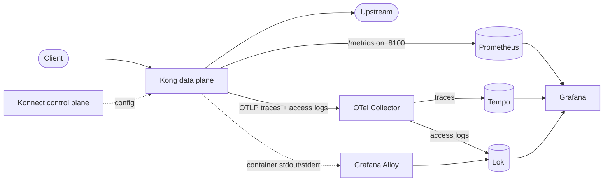

# Kong Gateway observability with Grafana

## Overview

When errors climb on a Kong route, a metric tells you *that* something broke. To see *why*, you need the request's log line and its trace. This repository wires all three from a Kong Gateway data plane (Konnect hybrid mode, on Kubernetes) into one Grafana:

- **Metrics:** the `prometheus` plugin, scraped by Prometheus, shown on Kong's official dashboard ([7424](https://grafana.com/grafana/dashboards/7424-kong-official/)).
- **Traces and access logs:** the `opentelemetry` plugin, sent over OTLP to an OpenTelemetry Collector, stored in Tempo and Loki. Each log line links to its trace, and back.
- **Container logs:** Grafana Alloy ships the Kong pods' stdout and stderr to Loki, for startup errors and crashes.



Everything runs on a kind cluster, with every chart and image pinned. One command stands it up.

## Prerequisites

- Docker, [kind](https://kind.sigs.k8s.io), `kubectl`, `helm`, [`task`](https://taskfile.dev) and [decK](https://github.com/Kong/deck)
- A Konnect account and a [personal access token](https://cloud.konghq.com/global/account/tokens)
- About 4 GB of memory for Docker: the kind node uses about 4 GB once everything runs

## Getting started

```bash
git clone https://github.com/bhatikuldeep/kong-grafana-observability-stack
cd kong-grafana-observability-stack
cp .env.example .env
# set KONNECT_TOKEN, and KONNECT_SERVER_URL if your Konnect region isn't EU

task up         # cluster, observability stack, Konnect control plane,
                # Kong data plane, Kong config and some test traffic
task validate   # checks that metrics, traces and both log streams arrived
task urls       # Grafana, Prometheus and Kong proxy addresses
```

If your machine can't reach the addresses from `task urls` (some Docker setups don't route to kind's network), forward Grafana instead:

```bash
kubectl -n observability port-forward svc/kube-prometheus-stack-grafana 3000:80
```

Log in as `admin`, with the password from `task grafana-password`. Then:

1. **Dashboards > Kong > Kong (official)** for request rate, status codes and latency per service and route.
2. **Explore > Loki**, query `{service_name="kong-gateway"}`, expand a line and select **View trace**.
3. **Explore > Tempo**, open a trace and select **Logs for this span** to go back.

When you're done:

```bash
task down               # deletes the kind cluster
task konnect-teardown   # deletes the Konnect control plane
```

## Reference

### What gets installed

| Component | Version |
|---|---|
| Kong Gateway (chart `kong/kong` 3.4.1) | 3.16.0.1, set by `KONG_IMAGE_TAG` in `.env` |
| kube-prometheus-stack | chart 92.21.1: Prometheus 3.16.0, Grafana 13.3.0, Operator 0.94.2 |
| OpenTelemetry Collector | chart 0.178.2: `otelcol-contrib` 0.163.2 |
| Loki | chart 7.5.0: Loki 3.6.11 |
| Tempo | chart 1.24.4: Tempo 2.9.0 |
| Grafana Alloy | chart 1.15.0: Alloy 1.21.3 |
| MetalLB | chart 0.16.2 |

Chart versions are set in `Taskfile.yaml`. To upgrade, change a version, then run `task reset` and `task validate`.

### Tasks

| Task | What it does |
|---|---|
| `task status` | Pods, ServiceMonitors and the data plane's Konnect connection |
| `task check-kong-version` | The Kong version actually running in the pod |
| `task break-servicemonitor-label` / `task fix-servicemonitor-label` | Reproduce and fix the "no Kong metrics" problem |
| `task body-capture-apply` / `task body-capture-revert` | Add request and response bodies to the access log for `mock-service`, then remove them |
| `task reset` | Delete and rebuild the cluster |

`task --list` shows all of them.

### Troubleshooting

| Symptom | Fix |
|---|---|
| No Kong target in Prometheus, and no error | The ServiceMonitor must carry `release: kube-prometheus-stack`, the label this Prometheus selects on (`values-dp.yaml.tpl`). |
| Dashboard shows `kong-kong-proxy` as the only service | Prometheus replaced Kong's `service` label with the Kubernetes Service name. `honorLabels: true` on the ServiceMonitor keeps Kong's. |
| Traces arrive, access logs don't | OTLP access logs need Kong Gateway 3.13 or later (`access_logs.endpoint` from 3.14). Check with `task check-kong-version`. |
| Kong exports fine but Loki or Tempo is empty | Kong only sees the Collector's reply. Read the Collector's logs: `kubectl logs -n observability -l app.kubernetes.io/name=opentelemetry-collector` |
| "View trace" opens an empty trace ID | Grafana expands `$VAR` in provisioning files, so link variables are escaped as `$${...}` in `values-prometheus-stack.yaml`. |
| `{namespace="kong"}` is empty | Normal on a healthy gateway: request logs go over OTLP and `proxy_access_log` is off. This stream fills on startup, reloads and errors. |

### Before production

- The Collector keeps every trace. Lower the sampling baseline, and keep errors and slow requests.
- Loki and Tempo use local storage with no persistence. Use object storage and set retention.
- Access logs include request headers. `Authorization` and `apikey` show as `REDACTED`, but other headers, such as `Cookie`, are logged as sent.
- Body capture logs payloads, which can hold tokens and personal data. Use it on one route, briefly.

### Licence

MIT. A personal project, not official Kong documentation.
