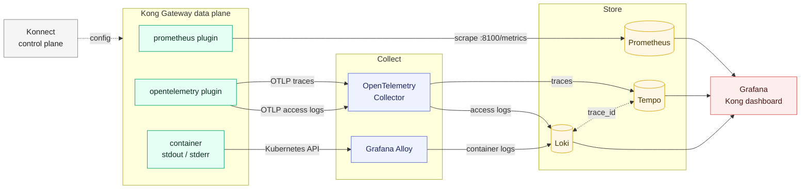

# Kong Gateway observability with Grafana

## Overview

When errors climb on a Kong route, a metric tells you *that* something broke. To see *why*, you need the request's log line and its trace. This repository wires all three from a Kong Gateway data plane (Konnect hybrid mode, on Kubernetes) into one Grafana:

- **Metrics:** the `prometheus` plugin, scraped by Prometheus, shown on Kong's official dashboard ([7424](https://grafana.com/grafana/dashboards/7424-kong-official/)).
- **Traces and access logs:** the `opentelemetry` plugin sends both over OTLP to an OpenTelemetry Collector, which stores them in Tempo and Loki. Each log line links to its trace, and back.
- **Container logs:** Grafana Alloy ships the Kong pods' stdout and stderr to Loki, for startup errors and crashes.



Everything runs on a kind cluster, with every chart and image pinned.

## Prerequisites

- Docker with about 4 GB of memory free (the kind node uses about 4 GB once everything runs)
- [kind](https://kind.sigs.k8s.io), `kubectl`, `helm`, [`task`](https://taskfile.dev) and [decK](https://github.com/Kong/deck)
- A Konnect account and a [personal access token](https://cloud.konghq.com/global/account/tokens)

## Getting started

```bash
git clone https://github.com/bhatikuldeep/kong-grafana-observability-stack
cd kong-grafana-observability-stack
cp .env.example .env
# set KONNECT_TOKEN, and KONNECT_SERVER_URL if your Konnect region isn't EU

task up      # cluster, observability stack, Konnect control plane, Kong data plane
task test    # sends traffic, checks metrics, traces and both log streams arrived
```

Both commands end by printing the Grafana address and login. If your machine can't reach that address (some Docker setups don't route to kind's network), forward Grafana instead and open http://localhost:3000:

```bash
kubectl -n observability port-forward svc/kube-prometheus-stack-grafana 3000:80
```

In Grafana:

1. **Dashboards > Kong > Kong (official)** for request rate, status codes and latency per service and route.
2. **Explore > Loki**, query `{service_name="kong-gateway"}`, expand a line and select **View trace**.
3. **Explore > Tempo**, open a trace and select **Logs for this span** to go back.

When you're done:

```bash
task down    # deletes the kind cluster, keeps the Konnect control plane
task clean   # deletes the cluster and the Konnect control plane
```

## Reference

### What gets installed

| Component | Version |
|---|---|
| Kong Gateway (chart `kong/kong` 3.4.1) | 3.16.0.1, set by `KONG_IMAGE_TAG` in `.env` |
| kube-prometheus-stack | chart 92.21.1: Prometheus 3.16.0, Grafana 13.3.0, Operator 0.94.2 |
| OpenTelemetry Collector | chart 0.178.2: `otelcol-contrib` 0.163.2 |
| Loki | chart 7.5.0: Loki 3.6.11 |
| Tempo | chart 1.24.4: Tempo 2.9.0 |
| Grafana Alloy | chart 1.15.0: Alloy 1.21.3 |
| MetalLB | chart 0.16.2 |

Chart versions are set in `Taskfile.yaml`. To upgrade, change a version, then run `task down`, `task up` and `task test`.

### Troubleshooting

| Symptom | Fix |
|---|---|
| No Kong target in Prometheus, and no error | The ServiceMonitor must carry `release: kube-prometheus-stack`, the label this Prometheus selects on (`values-dp.yaml.tpl`). |
| Dashboard shows `kong-kong-proxy` as the only service | Prometheus replaced Kong's `service` label with the Kubernetes Service name. `honorLabels: true` on the ServiceMonitor keeps Kong's. |
| Traces arrive, access logs don't | OTLP access logs need Kong Gateway 3.13 or later (`access_logs.endpoint` from 3.14). Check what runs: `kubectl -n kong exec deploy/kong-kong -c proxy -- kong version` |
| Kong exports fine but Loki or Tempo is empty | Kong only sees the Collector's reply. Read the Collector's logs: `kubectl logs -n observability -l app.kubernetes.io/name=opentelemetry-collector` |
| "View trace" opens an empty trace ID | Grafana expands `$VAR` in provisioning files, so link variables are escaped as `$${...}` in `values-prometheus-stack.yaml`. |
| `{namespace="kong"}` is empty | Normal on a healthy gateway: request logs go over OTLP and `proxy_access_log` is off. This stream fills on startup, reloads and errors. |

### Request and response bodies (optional)

`kong-body-capture.yaml` adds bodies to the access log for `mock-service` only. Apply it, and switch back to `kong.yaml` when done:

```bash
set -a; . ./.env; set +a
deck gateway sync kong-body-capture.yaml \
  --konnect-addr "https://$KONNECT_SERVER_URL" \
  --konnect-token "$KONNECT_TOKEN" \
  --konnect-control-plane-name "$CONTROL_PLANE_NAME"
# ...and back:
deck gateway sync kong.yaml \
  --konnect-addr "https://$KONNECT_SERVER_URL" \
  --konnect-token "$KONNECT_TOKEN" \
  --konnect-control-plane-name "$CONTROL_PLANE_NAME"
```

Loki flattens a JSON body into one field per key: `{"marker":"x"}` becomes `request_body_marker`.

### Before production

- The Collector keeps every trace. Lower the sampling baseline, and keep errors and slow requests.
- Loki and Tempo use local storage with no persistence. Use object storage and set retention.
- Access logs include request headers. `Authorization` and `apikey` show as `REDACTED`, but other headers, such as `Cookie`, are logged as sent.
- Body capture logs payloads, which can hold tokens and personal data. Use it on one route, briefly.

### Licence

MIT. A personal project, not official Kong documentation.
